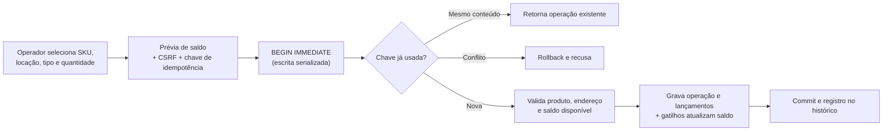
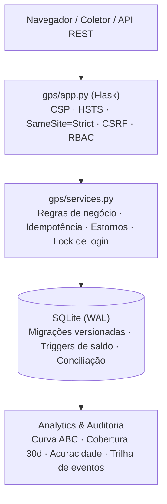
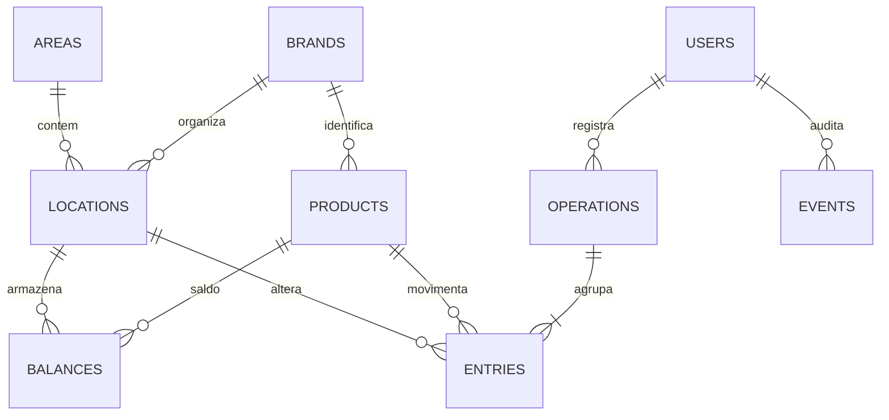

[](https://github.com/samu0752/GPSlogistic/actions/workflows/tests.yml)
[](https://codecov.io/gh/samu0752/GPSlogistic)

# GPSlogistic

Sistema de controle e rastreabilidade de estoque por SKU e locação feito em Python (Flask) e SQLite. Nasceu de um problema real de expedição: ao zerar um saldo pelo coletor, perdia-se a referência da quantidade anterior. Aqui cada movimentação grava saldo anterior, variação, saldo posterior, usuário, motivo e horário em um livro transacional; estornos compensam a operação original sem apagar o histórico.

## Fluxo e arquitetura

### Fluxo transacional de movimentação



### Arquitetura e controles



### Modelo relacional



Outros diagramas (estorno, UML de domínio e sequência) estão em [docs/DIAGRAMAS.md](docs/DIAGRAMAS.md) e [docs/ER.md](docs/ER.md).

## Funcionalidades principais

- **Rastreabilidade de estoque:** entradas, saídas, transferências entre locações, contagens físicas e estornos vinculados à operação original, com gatilhos no SQLite que impedem quebra de sequência entre saldo anterior e posterior.
- **Integridade e concorrência:** escrita serializada (`BEGIN IMMEDIATE` em WAL), chaves de idempotência contra reenvio duplicado e comando/tela de conciliação (`db.reconcile`) que valida o livro inteiro sem alterar dados.
- **Inventário e dados:** relatório de acuracidade (contagem física vs. saldo), ranking de divergências por SKU, curva ABC por unidades, movimentação diária (14 dias), estimativa de dias de cobertura (30 dias), importação de produtos via CSV, exportação CSV protegida contra fórmulas e script CLI (`exemplos/analise_historico.py`) com saída JSON.
- **Segurança e operação:** perfis (`operador`, `supervisor`, `admin`), troca obrigatória de senha inicial, limite de tentativas de login por conta e IP, trilha de auditoria (`/auditoria`), cabeçalhos HTTP de endurecimento, API REST de leitura documentada em [docs/openapi.yaml](docs/openapi.yaml), endpoint `/health` e Docker Compose.

## Como rodar localmente

Com Python 3.11+ na pasta do `manage.py`:

```sh
python -m pip install -r requirements.txt
python manage.py init --generate-password
python run.py
```

Acesse `http://127.0.0.1:5050/` e entre com o usuário inicial `samuel` usando a senha temporária exibida no terminal (a troca é exigida no primeiro acesso). No Windows também há o atalho `Iniciar GPSlogistic.cmd`; no Linux/macOS, `make run` ou `sh iniciar.sh`.

- **Conciliação e operação:** veja [docs/OPERACAO.md](docs/OPERACAO.md) para Docker Compose, backups e migrações.
- **Análise do CSV exportado:**

```sh
python exemplos/analise_historico.py gpslogistic-historico.csv --exportar-json resumo.json
```

## Testes e concorrência

```sh
python -m pip install -r requirements-dev.txt
python -m coverage run -m unittest discover -s tests -v
python -m coverage report
```

A suíte reúne testes unitários, integração, migrações e propriedades com Hypothesis. O CI executa testes, cobertura, `ruff`, `mypy`, `bandit`, `pip-audit` e validação do `compose.yaml`.

No teste de carga local (`python -m scripts.concurrency`), 100 requisições simultâneas de saída sobre saldo inicial 36 resultaram em 36 aceitas, 64 recusadas por falta de saldo e **zero divergências** na conciliação final.

## Documentação

- [Arquitetura e benchmark](docs/ARQUITETURA.md)
- [Regras de negócio](docs/REGRAS.md)
- [Segurança](docs/SEGURANCA.md)
- [API e OpenAPI](docs/API.md) · [openapi.yaml](docs/openapi.yaml)
- [Operação](docs/OPERACAO.md)
- [Changelog](CHANGELOG.md)

Projeto de **Samuel Xavier Sampaio**, sob a [licença MIT](LICENSE).
