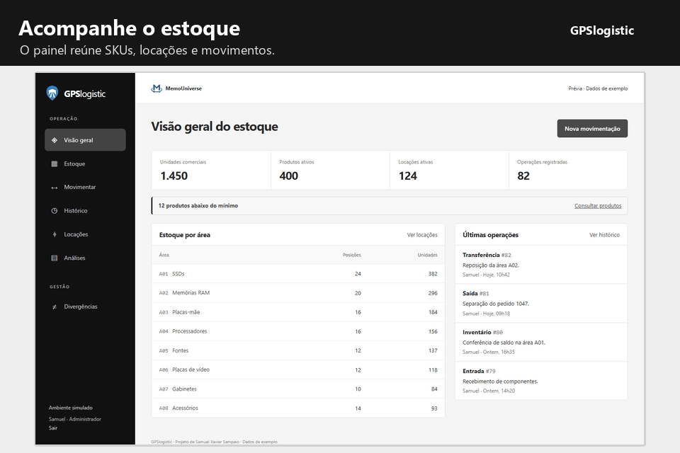

[](https://github.com/samu0752/GPSlogistic/actions/workflows/tests.yml)
[](https://codecov.io/gh/samu0752/GPSlogistic)

# GPSlogistic

[**Abrir demonstração HTML**](GPSlogistic-demonstracao.html) · [Guia do cenário](docs/DEMONSTRACAO.md)

## Problema observado na expedição

Ao zerar um saldo pelo coletor, a equipe perdia a referência da quantidade anterior. O GPSlogistic registra cada movimentação por SKU e locação, com saldo anterior, variação, saldo posterior, responsável e horário. Um estorno compensa a operação original e preserva os lançamentos posteriores.

## Demo

Abra a [prévia interativa](GPSlogistic-demonstracao.html) no navegador para explorar a interface e o estoque fictício. A prévia funciona localmente, e o workflow **Demo estática** prepara sua publicação no GitHub Pages.



## Como rodar em 3 comandos

Com Python 3.11 ou superior, na pasta que contém `manage.py`:

```sh
python -m pip install -r requirements.txt
python manage.py init --generate-password
python run.py
```

Abra [http://127.0.0.1:5050/](http://127.0.0.1:5050/) e entre como `samuel`. A senha temporária aparece no segundo comando e precisa ser trocada no primeiro acesso. O banco existente é preservado nas próximas execuções.

No Windows, também é possível executar `Iniciar GPSlogistic.cmd`. No Linux e macOS, use `make run` ou `sh iniciar.sh`. A [documentação operacional](docs/OPERACAO.md) descreve Compose, migrações e backups.

## Decisões técnicas

| Área | Decisão |
|---|---|
| Persistência | SQLite em WAL, migrações transacionais, escrita serializada e gatilhos no livro |
| História de estoque | Chaves de idempotência, cursor por ID e trilha de estorno |
| Inventário | Contagem, análise de acuracidade, ranking de divergências e revisão |
| Coletor | SKU ou código do fabricante, teclado, leitor externo e câmera experimental |
| Integração | CSV e API de leitura com sessão autenticada |
| Operação | Verificação em `/health`, eventos HTTP em JSON e Gunicorn no contêiner |

[Arquitetura e benchmark](docs/ARQUITETURA.md) · [Diagrama ER](docs/ER.md) · [OpenAPI](docs/openapi.yaml) · [Segurança](docs/SEGURANCA.md)

## Testes

```sh
python -m pip install -r requirements-dev.txt
python -m coverage run -m unittest discover -s tests -v
python -m coverage report
```

A suíte inclui os 37 testes originais, propriedades Hypothesis e cenários de migração e integração. O CI publica `coverage.xml` e verifica Ruff, Mypy, Bandit e pip-audit em workflows próprios. Os endereços dos badges pressupõem o repositório `samu0752/GPSlogistic`. Para publicar o badge percentual, configure `CODECOV_TOKEN` no repositório.

Em uma execução local com Python 3.12 e SQLite, `python -m scripts.concurrency` disparou 100 requisições simultâneas na rota de saída, com saldo inicial de 36. Foram aceitas 36, recusadas 64 por falta de saldo e detectadas **zero divergências**. Saldo final 0 em 5,779 s. O teste usa clientes Flask no mesmo processo e banco temporário.

## Limitações

- SQLite é a única persistência desta versão e mantém um escritor por vez.
- Câmera experimental depende de `BarcodeDetector`, permissão e contexto seguro. O teste com hardware depende de aparelho compatível.
- Pedidos, reservas e expedição integram o [roadmap](docs/ROADMAP.md).

O catálogo contém 400 modelos comerciais de RAM, SSD e HD. As marcas pertencem aos seus respectivos titulares e são citadas para identificar os modelos, sem vínculo comercial. A MemoUniverse, as 400 locações e as 8.000 unidades do estoque inicial são simuladas. [Origem e limites do catálogo](data/README.md)

Projeto de **Samuel Xavier Sampaio**, sob a [licença MIT](LICENSE).
