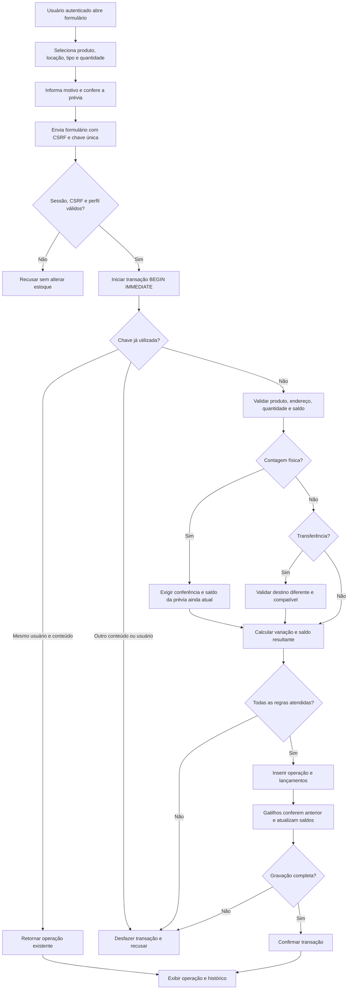
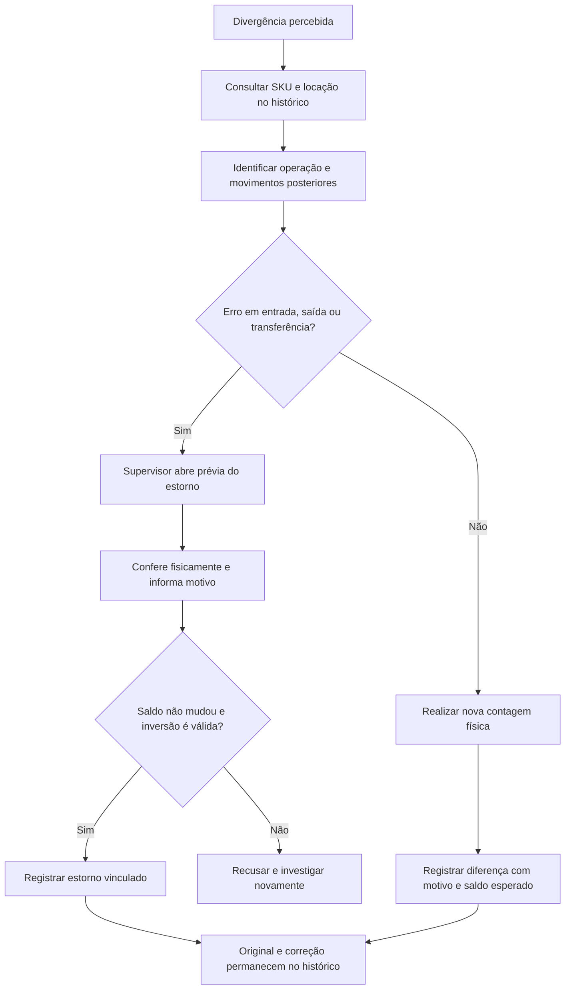
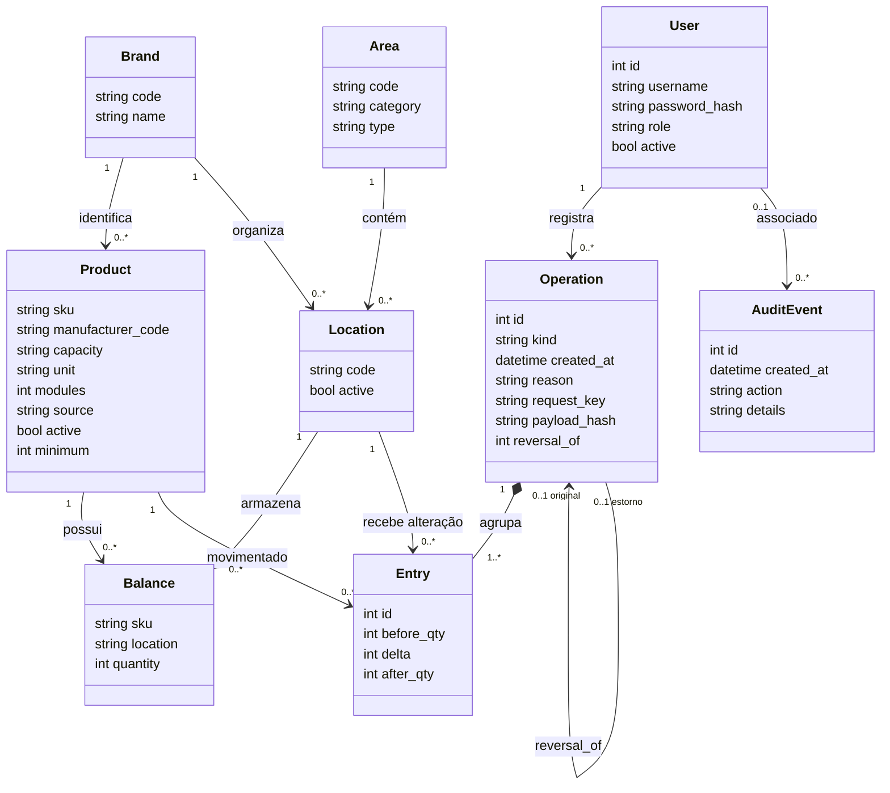
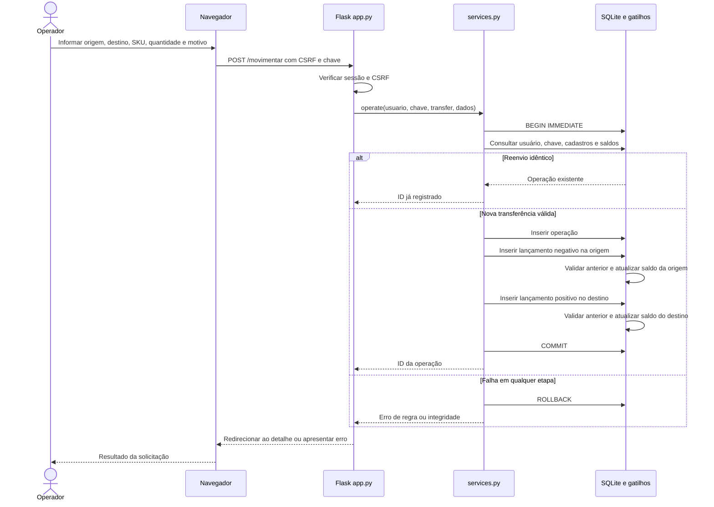
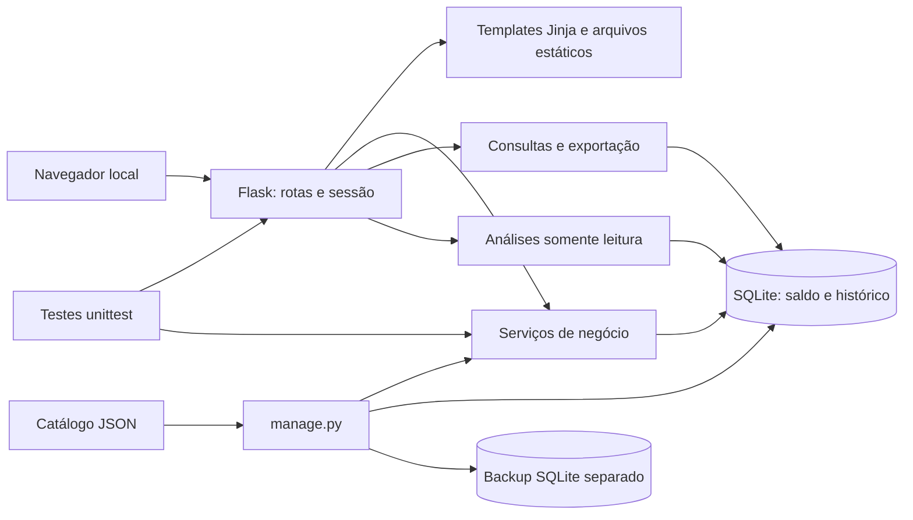
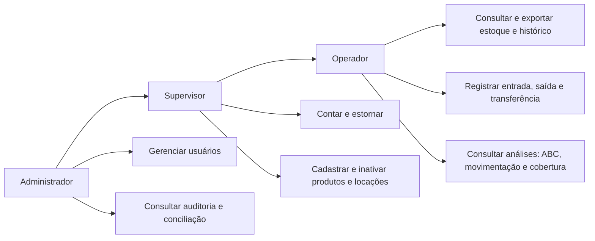

# Fluxogramas e UML

Os diagramas descrevem a versão 1 implementada. GitHub renderiza os blocos Mermaid ao abrir este Markdown. O diagrama de classes é um **modelo conceitual de domínio** correspondente às tabelas SQL; o código Python usa funções e registros SQLite, não classes ORM com esses nomes.

## Fluxograma de movimentação

## Fluxograma de investigação e correção

## UML — classes do domínio

A multiplicidade operação/lançamento representa uma transação concluída; uma inserção parcial é revertida. O banco permite registros técnicos transitórios dentro da transação, invisíveis como operação concluída para os demais clientes. Evento de login recusado pode não ter usuário associado.

## UML — sequência de uma transferência

## Componentes

## Mapa de casos de uso por perfil

Representação em fluxograma dos casos de uso; Mermaid não oferece a notação UML nativa de casos de uso neste documento.

As setas entre perfis indicam acúmulo de permissões, não herança entre classes Python. Pedidos, reservas e expedição não aparecem como componentes existentes porque ainda são evolução planejada.
