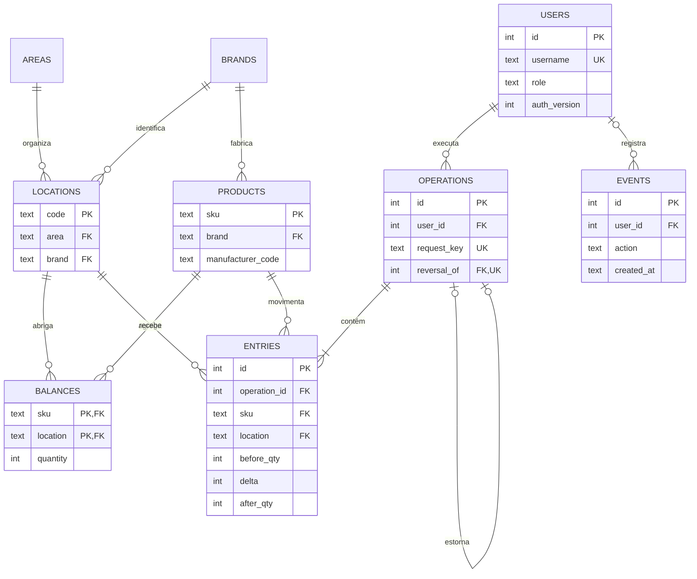

# Modelo entidade-relacionamento

O saldo é materializado por par SKU/locação. A mesma transação grava a operação e seus lançamentos. `schema_version`, `metadata` e os limitadores de login são tabelas de controle, sem chaves estrangeiras.
